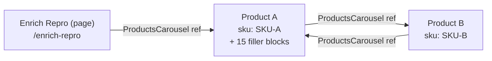
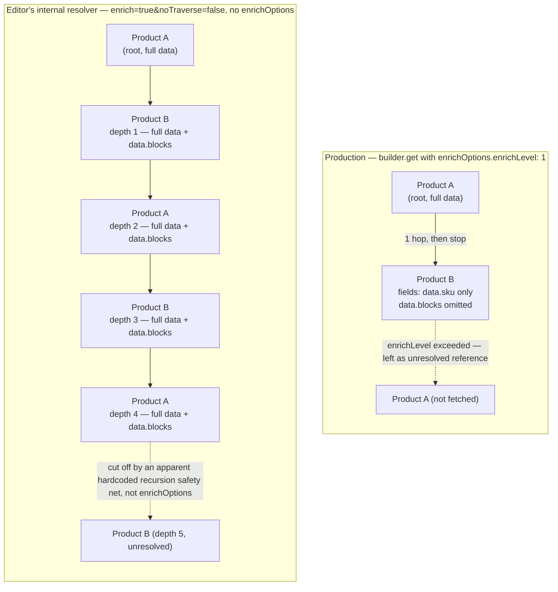

# Repro: Builder's visual editor doesn't respect `enrichOptions`

## Summary

Production rendering (`getStaticProps` → `builder.get('page', { enrichOptions })`) correctly
honors `enrichOptions` (depth cap + per-model `fields`/`omit`). Builder's **visual editor**,
when editing that same page, resolves references via a separate, Builder-internal mechanism
that ignores `enrichOptions` entirely and does uncapped, all-or-nothing enrichment — producing
a visibly different data shape than what actually ships to customers, and risking editor
hangs/crashes on cross-linked content.

## The two divergent code paths

- **Every content-delivery fetch** (`/api/v3/content`, `/api/v3/query`, GraphQL, SSR) shares one
  backend function (`modifyResult`) that supports per-request `enrich`,
  `enrichOptions.enrichLevel` (depth cap), and `enrichOptions.model.<name>.{fields,omit}`
  (per-model field shaping). This works correctly end-to-end.
- **Builder's admin editor** populates its preview/binding state via a separate internal
  reference-resolution path (`resolve-refs.function.ts`) that walks the draft content JSON for
  `@builder.io/core:Reference` nodes and fetches each one directly with only
  `enrich=true&noTraverse=false` — no depth limit, no `enrichOptions`, ever. It's gated only by a
  single org-wide boolean (Settings → Advanced → Performance → "Enrich references in editor
  preview"), not by anything set in application code.

Net effect: what an editor sees/binds against while authoring a page does not necessarily match
what ships. Because the internal editor fetch is uncapped, densely cross-linked content (e.g.
`product` ↔ `ProductsCarousel` reference cycles) can cause combinatorial fan-out in the editor
specifically, while the same content renders fine in production because the production fetch
actually bounds recursion via `enrichOptions.enrichLevel`.

## Repro content

Space: **NextJS Gen 1** (`e2628727c7b94df3a44ed2e3b4d1fde2`)

| Entry | Model | URL | ID |
|---|---|---|---|
| Enrich Repro | `page` | `/enrich-repro` | `6476264517cd49688ace7c70d09d150f` |
| Product A | `product` | `/product-a` | `eae08e9b6ea54cd8b4aeede334c4af11` |
| Product B | `product` | `/product-b` | `7e4608402a384927aad2ba6d915cb250` |

`ProductsCarousel` (`components/ProductsCarousel.tsx`) is a real React component registered via
`Builder.registerComponent` with a `products` input of type `list`, each item holding a `product`
subfield of type `reference` (model `product`) — not a schema-only placeholder. All references are
stored as plain static `@builder.io/core:Reference` data (not code bindings).

Topology — a genuine reference cycle:

```
Enrich Repro → Product A → Product B → Product A → ...
```

Product A also carries 15 filler blocks in `data.blocks`, so `enrichOptions.model.product.omit=
data.blocks` has real weight to strip.

## Reference graph

The authored content forms a genuine cycle — Product A and Product B each carry a
`ProductsCarousel` block referencing the other:



Production and the editor walk this same cycle completely differently:



## Reproduction steps

1. `npm run build && npm start`, then load `/enrich-repro`. In the Network tab, confirm the
   request to `/api/v3/content/page` includes `enrichOptions.enrichLevel=1` and
   `enrichOptions.model.product.fields=data.sku` (and `omit=data.blocks`), and that the
   `#debug-dump` panel on the page shows the Product A reference with only `sku` present (no
   `blocks`).
2. Open the same page (`/enrich-repro`) inside Builder's visual editor.
3. In devtools Network tab (inside the editor iframe context), filter for
   `/api/v3/content/product/<id>` requests (path has the content ID, not just the model name —
   that's the tell). Confirm they carry only `apiKey`, `enrich=true`, `noTraverse=false` — no
   `enrichOptions` at all.
4. Compare the data shown in the editor's state/bindings panel for the same product reference
   against step 1's dump — expect full, unfiltered product data (including `data.blocks`)
   instead of the `{ sku }`-only shape.
5. Because Product A ↔ Product B form a reference cycle, note editor load time / whether it
   hangs or errors — evidence of crash risk beyond just the data-shape mismatch.
6. Screenshot/record steps 3-5 for the ticket.

## Confirmed evidence

Hitting the same URL shape the editor's internal resolver calls directly (`cachebust=true` added
here only to bypass CDN caching for this test — the editor's own requests don't need it since
they're not repeatedly hitting a cached response):

```
https://cdn.builder.io/api/v3/content/product/eae08e9b6ea54cd8b4aeede334c4af11?apiKey=e2628727c7b94df3a44ed2e3b4d1fde2&enrich=true&noTraverse=false&cachebust=true
```

recurses through the A↔B cycle **5 levels deep** (`A → B → A → B → A`, cut off at depth 5 by
what appears to be a hardcoded recursion safety net unrelated to `enrichOptions`), returning full,
unfiltered `data` — including `data.blocks` — at every level, ~28KB total for this deliberately
minimal 2-node cycle.

Compare to production (`enrichLevel: 1`): resolves exactly **1** hop and omits `data.blocks`
entirely via `enrichOptions.model.product.omit=data.blocks`.

**Note on scale:** we also tested a denser 4-product mesh (each product referencing 2 others
instead of 1) against this same endpoint and observed the response grow from ~28KB to ~269KB —
30 references resolved, 32 more cut off at the depth boundary — for only a 2x increase in
fan-out per node. That test's content has since been removed from this repro to keep it simple,
but the finding is real: at a fixed ~5-level recursion depth, each additional reference per node
multiplies the resolved subtree rather than adding to it linearly. Real customer content with
even modest fan-out (3-4 references per node, common for "related products" style components)
would compound well beyond what this minimal repro shows — that's the actual mechanism behind
the "editor hangs/crashes" risk described above.

## The ask

Make the editor's internal reference resolver (`resolve-refs.function.ts`) depth-aware/capped —
or have it reuse `enrichOptions` — instead of always doing uncapped, all-or-nothing enrichment,
so editor-time behavior doesn't silently diverge from render-time behavior and doesn't crash on
cyclic content.
